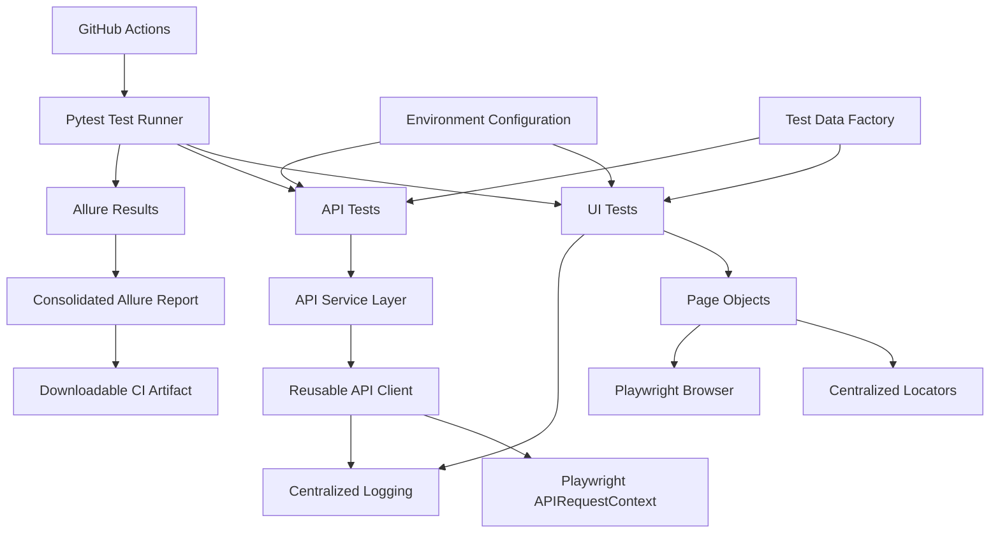
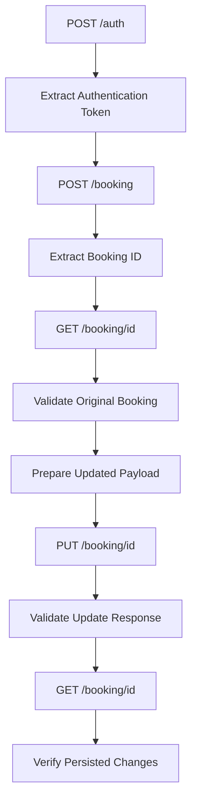
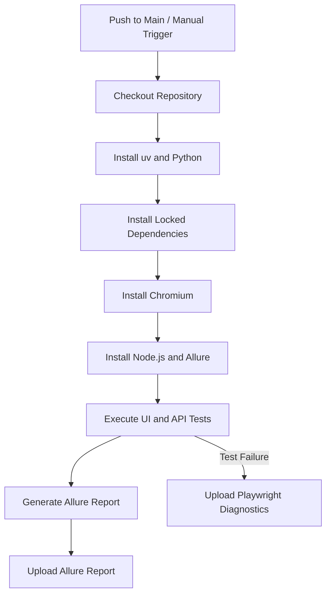

# Playwright Python Automation Framework

[](https://github.com/venkatsubramaniyan/PlaywrightPythonAutomation/actions/workflows/automation-tests.yml)

## Project Overview

A modular and scalable test automation framework built using Python, Playwright, and Pytest, supporting both UI and REST API automation within a unified architecture.

The framework demonstrates practical test automation engineering principles, including reusable components, environment-based configuration, parallel execution, API authentication, dynamic test data generation, centralized logging, consolidated reporting, and CI/CD integration.

## Key Features

- Unified UI and REST API automation
- Page Object Model (POM)
- Centralized locator and constant management
- Reusable API client and service layers
- API authentication and request chaining
- Hard and soft assertions
- Dynamic test data generation using Faker
- QA and UAT environment configuration
- Secure credential management
- Parallel execution using pytest-xdist
- Centralized UI and API logging
- Consolidated Allure reporting
- Screenshots, videos, and traces on UI test failures
- Automated execution through GitHub Actions
- Reproducible dependency management using uv

## Technology Stack

| Technology | Purpose |
|---|---|
| Python 3.13 | Programming language |
| Playwright | UI and REST API automation |
| Pytest | Test execution and fixture management |
| pytest-check | Soft assertions |
| pytest-xdist | Parallel test execution |
| Faker | Dynamic test data generation |
| python-dotenv | Environment configuration |
| Python Logging | Centralized execution logging |
| Allure 3 | Consolidated test reporting |
| GitHub Actions | Continuous integration |
| uv | Dependency and environment management |
| Git | Version control |

## Framework Architecture



## Project Structure

```text
PlaywrightPythonAutomation/
|
|-- .github/
|   `-- workflows/
|       `-- automation-tests.yml
|
|-- api/
|   |-- api_client.py
|   |-- auth_api.py
|   `-- booking_api.py
|
|-- config/
|   `-- settings.py
|
|-- constants/
|   |-- api_endpoints.py
|   |-- expected_messages.py
|   `-- products.py
|
|-- locators/
|   |-- account_locators.py
|   |-- account_success_locators.py
|   |-- cart_locators.py
|   |-- login_locators.py
|   |-- products_locators.py
|   `-- registration_locators.py
|
|-- pages/
|   |-- account_page.py
|   |-- account_success_page.py
|   |-- cart_page.py
|   |-- login_page.py
|   |-- products_page.py
|   `-- registration_page.py
|
|-- tests/
|   |-- conftest.py
|   |-- api/
|   |   `-- test_booking.py
|   `-- ui/
|       |-- test_login.py
|       |-- test_registration.py
|       `-- test_shopping.py
|
|-- utils/
|   `-- data_factory.py
|
|-- .gitignore
|-- pyproject.toml
|-- uv.lock
`-- README.md
```

## Framework Design

### UI Automation

The UI automation layer follows the Page Object Model design pattern.

- Page Objects encapsulate application interactions.
- Locators are maintained separately from Page Objects.
- Test cases focus on business workflows and validations.
- Page Object navigation supports reusable workflows.
- Playwright synchronization mechanisms are used instead of fixed delays.
- Expected messages and product information are maintained as reusable constants.

### API Automation

The API automation layer separates test logic, business-specific API services, and HTTP communication.

- APIClient provides reusable GET, POST, PUT, and DELETE operations.
- AuthAPI handles authentication token generation.
- BookingAPI encapsulates booking-related operations.
- API endpoints are maintained centrally.
- Pytest fixtures manage API request context creation and disposal.
- Authentication tokens and resource identifiers are passed between dependent API requests.

### Test Data Management

Faker generates dynamic test data for customer registration and booking operations.

This reduces reliance on hardcoded test data and supports independent test execution.

### Assertion Strategy

The framework uses both hard and soft assertions.

- Hard assertions validate critical prerequisites required for subsequent operations.
- Soft assertions allow multiple business validations within a single test.
- Playwright assertions support automatic waiting for UI conditions.

## Applications Under Test

| Application | Automation Type |
|---|---|
| [OpenCart Demo](https://naveenautomationlabs.com/opencart/) | UI |
| [Restful Booker](https://restful-booker.herokuapp.com/) | REST API |

## Test Coverage

### UI Automation

| Test Scenario | Coverage |
|---|---|
| Homepage Smoke Test | Homepage accessibility and title validation |
| Customer Registration | Dynamic customer data, registration and confirmation |
| Shopping Workflow | Login, product selection, cart notifications, cart contents and logout |

### API Automation

| Test Scenario | Coverage |
|---|---|
| Retrieve Booking IDs | HTTP status and response structure validation |
| Create Booking | Dynamic request payload and response validation |
| Update Booking | Authentication, request chaining and persisted data verification |

### API Request Chaining

The booking update scenario demonstrates an authenticated, end-to-end API workflow.



## Getting Started

### Prerequisites

- Python 3.13 or compatible later version
- uv
- Git
- Node.js and npm for Allure report generation

### Clone the Repository

```bash
git clone https://github.com/venkatsubramaniyan/PlaywrightPythonAutomation.git

cd PlaywrightPythonAutomation
```

### Install Dependencies

```bash
uv sync --frozen
```

### Install Playwright Browser

```bash
uv run playwright install chromium
```

### Install Allure CLI

```bash
npm install -g allure@3.33.0
```

## Environment Configuration

Create a `.env` file in the project root.

```dotenv
TEST_ENV=qa

QA_USERNAME=your_qa_username
QA_PASSWORD=your_qa_password

UAT_USERNAME=your_uat_username
UAT_PASSWORD=your_uat_password

API_USERNAME=your_api_username
API_PASSWORD=your_api_password
```

Valid registered OpenCart customer credentials are required for the shopping workflow.

Use the supported Restful Booker demo credentials for API authentication.

To switch environments, change the TEST_ENV value:

```dotenv
TEST_ENV=uat
```

The framework selects the corresponding UI credentials automatically.

The demo application URLs are shared by default. Separate application URLs can be configured using the optional UI_BASE_URL and API_BASE_URL environment variables.

The `.env` file is excluded from version control to protect credentials.

## Test Execution

### Execute All Tests

```bash
uv run pytest tests/ -v
```

### Execute UI Tests

```bash
uv run pytest tests/ui/ -v
```

### Execute API Tests

```bash
uv run pytest tests/api/ -v
```

### Execute Tests Sequentially

```bash
uv run pytest tests/ -v -n 0
```

### Execute Tests in Parallel

```bash
uv run pytest tests/ -v -n 2
```

The default configuration uses two parallel workers.

UI tests execute in headed mode locally and headless mode in GitHub Actions.

## Centralized Logging

The framework uses Python's built-in logging module with centralized Pytest logging configuration.

UI logging captures meaningful business operations, including:

- Customer registration
- Login and logout
- Product selection
- Shopping cart verification

API logging captures:

- HTTP request methods
- API endpoints
- HTTP response status codes

Example API logs:

```text
INFO api.api_client - POST /auth
INFO api.api_client - POST /auth - Status: 200
INFO api.api_client - POST /booking
INFO api.api_client - POST /booking - Status: 200
```

Passwords, authentication tokens, cookies, and request payloads are deliberately excluded from application logging.

Live terminal logging can be viewed during sequential execution. Parallel execution may suppress live terminal logs.

## Allure Reporting

The framework generates consolidated Allure results for both UI and API tests.

### Generate the Report

```bash
allure generate allure-results
```

### Open the Report

```bash
allure open allure-report
```

The report provides:

- Overall execution summary
- Passed and failed test results
- Individual test execution details
- Test execution duration
- Captured test logs where available

## Failure Diagnostics

Playwright is configured to retain diagnostic artifacts when UI tests fail:

- Screenshots
- Browser videos
- Playwright traces

These artifacts support troubleshooting and root cause analysis.

## Continuous Integration

GitHub Actions automatically executes the complete automation suite whenever changes are pushed to the main branch.

Manual execution is also supported through workflow dispatch.

### CI Workflow



### CI Capabilities

- Automated execution on Ubuntu runners
- Headless browser execution
- Parallel test execution
- Secure credential injection using GitHub Secrets
- Consolidated Allure report generation
- Downloadable report artifacts
- Failure diagnostic artifact collection

### GitHub Secrets

The following secrets are configured for CI execution:

- QA_USERNAME
- QA_PASSWORD
- UAT_USERNAME
- UAT_PASSWORD
- API_USERNAME
- API_PASSWORD

### View CI Reports

1. Open the repository on GitHub.
2. Navigate to the Actions tab.
3. Select the required workflow execution.
4. Download the allure-report artifact.
5. Extract the downloaded ZIP file.
6. Open a terminal inside the extracted directory.
7. Execute:

```bash
allure open .
```

## Engineering Practices

- Separation of concerns
- Reusable and maintainable components
- Independent test scenarios
- Centralized configuration
- Secure credential handling
- Dynamic test data management
- Parallel execution
- Automated regression execution
- Execution observability and failure diagnostics
- Version-controlled dependency management

## Project Status

The framework includes six automated test scenarios:

- 3 UI tests
- 3 API tests

All six tests have been successfully executed locally and through GitHub Actions.

This project serves as a practical demonstration of modern test automation framework design, implementation, and continuous integration.

## Author

Venkat Subramaniyan

[GitHub Profile](https://github.com/venkatsubramaniyan)
